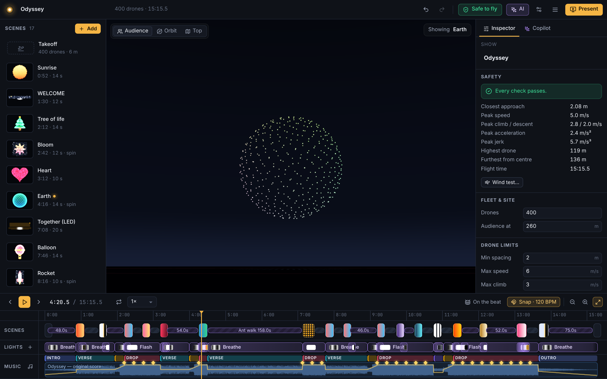

# Drone Show Designer

Design drone light shows in the browser: arrange formations on a timeline, sync them to music, layer light cues on top, and preview the result from the audience's seat. Every edit is checked for safety, and the checks are exact.

Built for small agencies and operators who need to go from an idea to a convincing client preview quickly, without giving up a show that can actually fly.



## The flagship show

**Odyssey** (File → New show) is a 15-minute, 400-drone show in four acts, built entirely through the editor's own model API and required by the tests to pass every safety check. It plans in the background in a few seconds. It comes with its own **original score**, composed to the show like a film score. Every formation arrives on a bar line, and each act builds into a drop that hits exactly as its hero formation lands: the tree, the Earth, the LED sign, Saturn and the ring of fire. THANK YOU gets a quiet break, and the landing gets an outro. The lights follow the score.
- **Dawn:** a breathing sunrise that ripples up from the pads, and WELCOME written on over a starfield.
- **Earth:** a swaying 3D tree, a bloom, a beating heart, and a swirling Earth. Then an ant-walk column marches over an arch into an LED sign scrolling "TOGETHER WE SHINE".
- **Sky:** a bobbing hot-air balloon, a rocket that launches on a strobe, Saturn swirling in, a galaxy with a halo and starfield, and a cascading helix.
- **Finale:** THANK YOU flipping into place inside a frame, a ring of fire, a gold star, a bursting firework with flashes, and GOOD NIGHT written on. The drones then rain down to land.

## How it works

A show is a sequence: **takeoff → scene → scene → … → return & land**. Each scene is a formation that the drones hold for a while. Between scenes, the drones fly.

- **Formations come from shapes, text, or images.** There are 2D shapes (circle, heart, star, polygon, grid, spiral, wave), 3D shapes (sphere, torus, cube, double helix, cone), text in sans, serif or dot-matrix fonts, and image/logo import where each drone takes its pixel's colour. A scene can combine several shapes and share the drones between them.
- **Edit in the 3D view.** Select a formation (or click its drones) and move, rotate or scale it with the gizmo (**W E R**). It snaps to 1 m, 5° and 5% steps; hold Alt to move freely. While you drag, a ghost of the formation follows instantly. The floor, ceiling and fence light up, and the ghost turns red if it leaves the airspace. Scaling stops at the smallest safe size. **Alt + arrows** nudge the formation, and **F** frames it.
- **Idle drones have a job.** When a formation doesn't need every drone, the spares can be *parked* dark behind it, become a dim twinkling *starfield*, a *halo* ring, a *frame*, or a *base* band of light beneath it. Long holds can *breathe* (grow and settle back), *bob* or *sway*. Each motion runs whole cycles that start and end at rest. Breathing only ever widens the gaps, and bob and sway move the formation rigidly, so no motion can bring drones closer together. Amounts default to a safe fraction of what the formation can do.
- **New formations are safe by default.** Each one is sized so that drones sit at least √2 × the minimum spacing apart, and it is lifted above the airspace floor.
- **Flights are planned for you, collision-free.** Drones are matched to their next positions by an optimal assignment (Hungarian algorithm, minimising total squared distance). They all fly straight lines on one shared S-curve timing profile: ease in, cruise, ease out. The duration is computed from your speed, acceleration and jerk limits. You can make a flight longer, but never unsafely short. If a straight flight would bring two drones too close (dense formations), the planner takes a **detour**. The formation spreads out (every gap grows), crosses to a spread-out copy of the target, then closes in. The timeline marks these flights.
- **Transitions are part of the show.** Every flight can be *direct* (everyone straight and together, the fastest) or a spectacle:
  - **cascade:** drones set off in a ripple, left to right, centre out, top down and so on;
  - **swirl:** the flying formation turns on the way, by any angle;
  - **burst:** it explodes outward mid-flight, then reforms;
  - **ant walk:** the formation files into a column that marches up, over an arch and down the far side, then blooms into the new shape;
  - **rain:** drones drip down onto a low carpet, then rise into the new shape, top first.

  Spectacle transitions take longer than direct flights; the ant walk and rain are showpiece moments (roughly a minute on mid-sized formations). The timeline shows each style and its duration.
- **Groups: splits and merges.** After a formation's hold, its drones can split into groups. You can split by shape, into left and right halves, top and bottom halves, or three columns. Each group flies its own sequence of formations at its own pace, and can set off with a delay. Drones in no group keep holding the formation. The next scene merges everyone back together.
  - The split itself is one synchronised flight out of the formation, planned (with a detour if needed) and checked exactly like any flight. After that each group keeps its own clock.
  - Group formations are ordinary scenes sized for their group's drones, so every editor works on them.
  - The timeline shows a row per group, with draggable timing. The scene list nests each group's formations under its scene. Clicking a drone during a split selects the formation its group is flying.
  - New group formations are laid out so groups keep apart, and a one-click fix moves overlapping groups apart.
- **Text can perform.** Text formations know which letter each drone belongs to and its pen order, recovered by thinning each letter to a skeleton and tracing it. So text can be:
  - *written on* stroke by stroke with a glowing pen tip (other shapes get drawn along their outline);
  - *typed* letter by letter with a blinking cursor;
  - *flipped* like a split-flap board.

  **LED signs** are grids where each drone is one dot of a dot-matrix font, scrolling text column by column like a marquee. Two fonts: 5×7, or 3×5 for small fleets (a 5×12 panel of 60 drones shows three letters at a time). Set the panel to any size, such as 8 × 10; text stays on exact rows and is centred when the panel is taller than the font. These are light effects, so they also work as cues.
- **The real site.** In **Site** (show settings), place the show on a street map by searching for a place, or by pasting coordinates or a map link. Set the compass bearing the audience faces, then draw on the map:
  - **Keep-out zones:** the audience area, obstacles with a height (buildings, trees, masts), or no-fly areas. Each has a buffer drones must also keep.
  - **The permitted flight area**, for example from your permit.

  Every drone is checked against them for the whole show, takeoff and landing included. When a held formation intrudes, the fix moves it just clear. Moving or turning the site keeps zones where they are on the ground. The 3D view shows zones as volumes, and can lay the map (dimmed for night) under the show so clients see it at the real venue.
- **Position accuracy.** Real drones are never exactly on their planned path. Set your positioning system's accuracy, for example RTK at ±0.1 m across and ±0.15 m up and down. Every clearance then allows for it: spacing grows by twice the accuracy, and floor, ceiling, fence and zones by the accuracy. Planning, sizing and checks all use the widened values.
- **Lights are first-class.** Each shape has a base look: solid, gradient, rainbow, pulse, twinkle, chase, wave, image colours, or lights off. On top of that, **light cues** sit on their own timeline track: flashes, strobes, washes, sweeps and blackouts. They can span scenes and flights, blend over the base look (replace, tint, add), and fade in and out.
- **Music is the backbone.** Drop in a song and the editor works out its structure:
  - **beats** (spectral-flux onsets, tempo by autocorrelation, a dynamic-programming beat tracker);
  - **loudness, bass and brightness** for every beat;
  - **accents**: the stand-out hits, such as crashes and drops;
  - **sections**, labelled intro, verse, build, drop, break or outro. Sections are found from bar-level changes in loudness, bass and brightness, and snapped to 4-bar phrases.

  The music lane shows the sections as coloured bands, accents as markers, and the loudness curve. Timeline edits snap to beats. From the music menu:
  - **Light the music** (bold or subtle) adds cues that follow the song's structure: breathing with the loudness in quiet parts, a sweep and beat flashes building into each drop, a flash on every accent in drops, sparkle in breaks, and a fade in the outro. Running it again replaces only its own cues.
  - **Fit show to song** lands every arrival on a bar line. It then stretches or tightens holds, bar by bar, so the finale ends with the music. Flights never get faster than safe.

  Lights can react to the music directly. *Breathe* brightness follows the loudness, a *level meter* fills with it, and flashes can fire on accents instead of every beat.
- **No song? Compose one.** *Compose a score for this show* (music menu) writes an original soundtrack to your show. Arrivals move onto a bar grid, and the music builds and drops exactly as the hero formations arrive. It's synthesised in the browser (pads, arpeggio, bass, drums, risers, crashes, lead), so the editor knows the score exactly: beats, sections and hits. The project saves only the recipe, and the music is regenerated when you open it. Use it as a temp track for client previews, or as the show's music. Undo brings your previous song back.
- **Client preview.** *Present* plays the show fullscreen from the audience position, with music.

## AI features

Optional, powered by Claude Opus 5.5. Open **AI** in the top bar or press **Ctrl K**.

- **Generate a show from a brief.** Describe the occasion, story, colours and words. Claude writes a structured plan (scenes, lights and cues). With music, the song is the backbone: Claude reads its sections and accents and puts the hero formation exactly on the biggest drop. The engine lands every other formation on a bar, fits the finale to the end of the song, lights the music, and applies automatic safety fixes. With no song, Claude picks the hero formations and a tempo, and an original score is composed with its drops on them. You preview the result before it replaces your show, and it's one undo step.
- **Copilot.** Edit by conversation: "make the heart pink and slow the globe", "add flashes on the drop", "review my show". It works through 24 tools that edit the show the same way the UI does. They include the music tools (read the song's structure, land a formation on a section or bar, fit to the song, light the music, compose a score) and the group tools (split a scene, add a formation to a group, edit a group). It sees the site's keep-out zones, flight area and position accuracy. Each tool reports the safety status back, so the model sees the consequences of its own edits. It can *look* at rendered formations (vision) to judge readability and colour. Everything it does for one request is a single undo step.
- **Describe a formation.** Words become a bold SVG drawing, which becomes drones in the drawing's colours. "Refine" shows Claude how its drawing actually came out as drones, so it can fix what doesn't read.
- **Create a 3D model — with look and fix.** Describe an object ("a hot-air balloon with a basket"). Claude builds it from solid parts (spheres, ellipsoids, boxes, cylinders, cones, capsules, tori, each with its own colour), and the engine spreads the drones evenly over the outer surface. Then Claude *looks* at the actual drones from the front, side, top and a three-quarter angle, says what doesn't read (a part that's too thin, a missing feature, wrong proportions), and fixes the model. It repeats until it's satisfied or the round limit (1–3) is reached. You can add your own feedback for more rounds, and reopen any 3D model from the inspector with **Improve**. The copilot and the show generator can create 3D models too, and the copilot can look at any scene from all four angles.
- **Write a client pitch.** A proposal written from the real show: its formations (as images), timeline, music and exact safety figures. Unknowns like dates and prices become `[placeholders]`.

**The model proposes; the engine decides.** Model output never bypasses the safety engine. Every number is clamped, every colour validated, and every formation goes through the same sizing, airspace and validation path as a manual edit. Tool inputs are schema-checked before they run, and a response cut off mid-tool-call is never executed.

**Keys and privacy.** The editor is a static web app, so requests go straight from the browser to the Claude API with your own key. The key is stored only in that browser's localStorage. Anyone with access to the browser profile could read it, so for shared machines or a public deployment, set a **proxy URL** in AI settings instead. Your proxy should forward to `https://api.anthropic.com` and set the real key; the SDK sends the credential as `Authorization: Bearer …`, which the proxy should replace. If a safety classifier declines a request, it's retried automatically on Anthropic's recommended fallback model (server-side refusal fallback). Token use for the session is shown under the copilot.

## Safety checks

Checks run in a background worker after every edit. Each issue links to the moment it happens and, where possible, offers a one-click fix.

| Check | How |
|---|---|
| Minimum distance in formations | Every pair, every formation. Spin, bob and sway are rigid motions, and breathing only scales up, so held spacing is never below the base spacing. |
| Minimum distance during flights | Every pair, on every leg, closed form. With shared timing, the distance between two drones is \|A + s·B\|, so its minimum over the leg is solved analytically, not sampled. Swirl and burst only rotate and enlarge the flying formation, so this bound covers them too. Cascade, rain and ant walk are checked on a fine time grid. Between grid points each path stays within a·Δt²/8 of its chord, so the closest approach of the chords minus that margin is a proven lower bound. |
| Speed (horizontal, climb, descent), acceleration and jerk | Exact peaks of each leg's S-curve. Spin and idle motions are measured on the closed-form trajectory of their fastest-moving drones. Unsafe motion gets a "calm" fix. |
| Altitude floor and ceiling, flight radius | Straight legs peak at their endpoints, so formations, pads and detour waypoints are checked there. Spinning, swaying, breathing and bobbing formations are bounded over their whole range of motion. |
| Between groups during a split | Groups don't share a clock, so the closed form doesn't apply. Separation is proven with a speed bound instead. No drone moves faster than v, so between samples Δt apart a pair at distances d₀ and d₁ stays at least (d₀ + d₁)/2 − v·Δt apart. Where that isn't enough, the interval is bisected until the bound clears it or a sample shows a real close pass. Pairs are found with a spatial hash, and the results are tested against 5 ms brute-force sampling. Each group's own flights and formations get the exact checks above. |
| Keep-out zones and the flight area | The same proven speed-bound method, for every drone against each zone (distance to the zone's prism minus its buffer and the position accuracy) over the whole show. |
| Position accuracy | All of the above use clearances widened by the accuracy, so the plan is safe wherever within its accuracy each drone really is. |
| Battery | Total flight time, takeoff to landing. |

How transitions stay safe:
- **Swirl and burst** inherit the plain flight's exact proof, since rotating or enlarging the formation can't bring drones closer.
- **Ant walk** is safe by construction. The column marches in lockstep, each lane in its own plane in front of or behind the formations, with drones at least a spacing apart along each lane. Getting into and out of the column are synchronised flights.
- **Cascade and rain** keep the plain flight's exact timing and only delay each drone's start. If the ripple would bring drones too close, it is softened to the strongest safe stagger. Rain's last resort falls and rises together.
- **Fallback:** if a style can't be made safe, the flight flies direct, and the inspector says why. Speeds, accelerations, jerk and the airspace are checked on the styled paths too.

Why formations spaced ≥ √2 × min spacing always fly clear: with optimal assignment and synchronised straight-line motion, start and end separations above 2√2·r keep robots of radius r from colliding (Turpin, Michael & Kumar, “Concurrent assignment and planning of trajectories for multiple robots”, IJRR 2014). The validator doesn't rely on this; it checks every pair anyway.

The preview, the validator and the exporter all call the same `evaluate()` function, so what you see is exactly what gets exported.

### Wind test

The checks prove the *plan* is safe. The **wind test** shows how much margin it leaves in real air. It flies every drone through a physical simulation:

- thrust limited in magnitude and tilt (35°), with a response lag;
- quadratic drag against the relative wind;
- wind that grows with altitude (power law), gusts that travel with the wind, and turbulence on each drone;
- a PID position controller with feed-forward of the planned acceleration, which doesn't know the wind.

It reports the real closest approach next to the planned one, the largest and typical drift, and the time drones spend at their control limits. It lists the closest calls (click one to jump there). **Watch in viewport** replays the simulated, blown-about flight. The simulation runs in its own worker. Its results are an engineering estimate, not a certification.

## Export

- **Project** (`.droneshow.json`): the full show, with the music embedded (a composed score is saved as its recipe).
- **Trajectories** (ZIP): one CSV per drone with columns `time_s, east_m, north_m, up_m, red, green, blue`, sampled at 5–20 Hz. Coordinates are ENU metres from the centre of the takeoff grid. With a site location they are true east and north (the show turned to the audience's heading), with added `lat_deg, lon_deg` columns (WGS84). A `site.json` lists the origin, the zones and the flight area. Without a location, the audience is assumed to stand to the south.

Formats for specific flight controllers and show systems are planned.

## Keyboard

| | |
|---|---|
| Space | Play / pause |
| ← → (Shift) | Seek 1 s (5 s) |
| ↑ ↓ | Previous / next scene |
| A / C | Add formation / light cue at playhead |
| Ctrl D, Delete | Duplicate, delete |
| Ctrl Z, Ctrl Shift Z | Undo, redo |
| 1 2 3 | Audience / orbit / top view |
| Q W E R | Select / move / rotate / scale the selected formation in the view (Alt: no snapping) |
| Alt ← → ↑ ↓ (Shift) | Nudge the formation across / up and down, 1 m (5 m) |
| Alt PgUp / PgDn | Nudge it away from / toward the audience |
| F | Frame the selected formation |
| P | Present |
| Ctrl S | Save project |
| Ctrl K | Ask the AI copilot |

Drag any number field's label to scrub it (Shift ×10, Alt ×0.1). Hold Alt while dragging on the timeline to bypass beat snapping.

## Development

```bash
pnpm install
pnpm dev          # http://localhost:5173
pnpm test         # unit tests (engine, validator, beats, export, demos, AI converters and agent loop)
pnpm test:e2e     # browser tests, incl. AI features against a mocked Claude API (no key needed)
                  # (Playwright; run `pnpm exec playwright install chromium` once)
pnpm typecheck && pnpm lint && pnpm build
```

```
src/
  core/      Pure, deterministic engine: model, shapes, assignment, motion profiles,
             compile → flight plan (with collision-free detours and spectacle transitions),
             evaluate(t), exact validator, idle drones, text pen order, wind simulation,
             music (beats, sections, accents, music tools, score synthesiser), groups and splits,
             the real site (geo, zones, position accuracy, proven speed-bound checks), export, file format
  engine/    Web Workers: compile + validate, beat analysis and score rendering off the main
             thread; wind simulation
  state/     Zustand store (document + undo history), playback clock, actions, autosave & files
  ui/        React: scene list, 3D viewport (react-three-fiber), timeline, inspector, present mode
  ai/        Claude features: client, copilot agent loop + tools, director, formation drawing,
             3D models with look-and-fix, pitch writer; schemas and converters that route model
             output through the engine
  app/       Built-in demo shows (CI requires every demo to pass every check)
```

## Roadmap

- Hardware export formats
- Video export and shareable preview links
- An audience-view overlap check (drones that are safely apart but merge into one dot from the ground)
- Gizmo editing of individual shapes within a scene, and a "find the wind limit" sweep
- Elevation data for sloped sites (altitudes are above the takeoff ground)

## License

[MIT](LICENSE)
