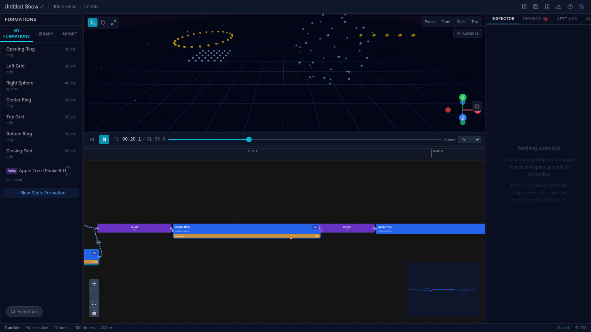

# Drone Show Designer

A browser-based, node-based editor for designing aerial drone light shows — built from the graph model up, with a live 3D viewport, a deterministic export pipeline, and an in-app AI agent that can author and modify shows through tool calls.

**Live: [drones.prototyp.ms](https://drones.prototyp.ms)** — actively developed (work in progress).

> **Stack:** TypeScript · React 18 · Three.js / React Three Fiber · React Flow · Zustand · Vite · Vitest · Playwright · Web Workers · Tailwind



---

## Why it's interesting

Most drone-show tooling is Blender plugins or proprietary desktops. This is a from-scratch, web-native editor with a real engineering spine:

- **Graph-as-source-of-truth architecture.** A single typed `ShowGraph` (`launch → formation → transition → idle → land` nodes, with `flow` and `attachment` edges) is the canonical state. The React Flow canvas, the Three.js viewport, the inspector panels, the validator, and the exporter are all *derived views* of that one model. No duplicated state, no drift.
- **Two-tier evaluation: live preview vs. bake.** A fast `evaluateAtTime()` path runs on the main thread (sub-16ms for 60 fps scrubbing) with deliberate approximations. A separate deterministic `bakeShow()` runs in a Web Worker with full physics enforcement and is the only thing that produces export trajectories. The contract between the two is explicit and tested.
- **AI agent integrated as a first-class editor surface.** A Claude tool-calling agent has access to **30+ typed tools** (read + write) that operate directly on the graph: `create_formation_from_text`, `add_transition_node`, `set_color_program`, `generate_music_synced_show`, `analyze_image_for_formation`, `fix_all_violations`, etc. Every write tool snapshots history first, so any AI change is undoable with Ctrl+Z.
- **Strong test coverage on the hard parts.** ~41 test files, ~7.9 k LOC of tests covering the graph evaluator, transition strategies, ant-trail interpolation, physics validation, time pushing, topology, split/merge flow assignment, serialization round-trips, and store cross-interactions.

---

## What's in the box

### Editor (root project)

- **Node-based show graph.** Add launches, formations, transitions, idles, and lands; wire them with flow edges; attach idle behaviors to formation nodes. Drag, group, search via `Ctrl+K`, undo/redo, keyboard-driven.
- **3D viewport.** Live Three.js preview of drone positions and colors, scrubbable timeline, transport controls, formation gizmo for direct manipulation, point-level editing.
- **Formation library.** 7 procedural generators (ring, grid, sphere, spiral, line, heart, star), 3 animated formations (firework burst, apple-tree shake, breathing sphere), free text-to-points via the AI generator.
- **8 transition strategies:** stagger, spiral, explosion, implosion, cascade, morph, color-sweep, bounce — each with its own point mapping and minimum-duration estimator.
- **11 idle behaviors** for attached drones: hover, orbit, breathe, random-walk, figure-8, swarm, sparkle, pulse, wave, spin, drift — with per-axis inheritance flags.
- **10 color programs:** solids, gradients, rainbows, pulses, chase patterns.
- **Physics-aware validation.** Per-segment velocity (horizontal + vertical), acceleration, drone-pair spacing, altitude floor / geofence. Auto-fix patches available for common violations; auto-timing assigns durations to satisfy constraints.
- **Crash recovery.** IndexedDB autosave; offers to restore the most recent in-progress show on reload.
- **Export.** Per-drone CSV waypoint bundles (zipped, ENU or NED), full project JSON, optional MP4 video render. Bake output is deterministic — same graph, same constraints, same trajectories.

### Standalone (`standalone/`)

A smaller, chat-only companion app that takes a natural-language prompt → produces drone keyframes → previews them in 3D → exports a `formation.json` + paste-in Blender import script. Same physics validator as the main editor, ~1.2 k LOC, no graph.

---

## Architecture at a glance

```
src/
├── graph/         # Pure model & engine: types, topology, timing, evaluate, bake, validate, serialize
├── registries/    # Pluggable strategies: generators, transitions, idle behaviors, color programs
├── stores/        # Zustand stores: graph, formations, project, playhead, history, view, selection, AI chat
├── services/      # IO, autosave, bake worker, exports, AI service (Claude API), AI tools, image analysis
├── components/    # canvas/ (React Flow) · viewport/ (R3F) · inspectors/ · panels/ · dialogs
└── app/           # App shell, layout, demo seeds
```

**Architectural laws** (enforced by code + tests):

1. `ShowGraph` is canonical. Everything else derives.
2. Live preview is allowed to approximate; bake is not.
3. Transitions own point mapping, entering/exiting drones, and motion interpolation — but never timing or drone-count allocation.
4. Registries are the only extension surface — adding a transition, generator, or color program is a single `register…()` call.

See `src/docs/PREVIEW_VS_BAKE.md` for the preview ↔ bake contract.

---

## Getting started

```bash
pnpm install
pnpm dev          # http://localhost:5173
pnpm typecheck    # strict TS, no emit
pnpm test         # vitest
pnpm test:e2e     # playwright
pnpm build        # production bundle
```

The standalone app:

```bash
cd standalone
npm install
npm run dev
```

AI features are optional. Add a Claude API key in-app (Settings → AI). Without a key the editor works fully; the chat panel is disabled.

---

## CI

GitHub Actions runs `typecheck → lint → test → build` on every push and PR. See [`.github/workflows/ci.yml`](.github/workflows/ci.yml).

---

## Project shape

| | |
|---|---|
| Source files (excl. tests) | 110 |
| Source LOC (excl. tests) | ~22.7 k |
| Test files | 41 |
| Test LOC | ~7.9 k |
| Registered AI tools | 30+ |
| Transition strategies | 8 |
| Idle behaviors | 11 |
| Formation generators | 7 + 3 animated |

---

## License

[MIT](LICENSE) — © Willi Krappen. Part of my portfolio at [prototyp.ms](https://prototyp.ms).
